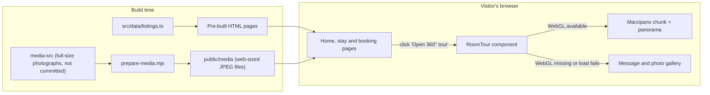
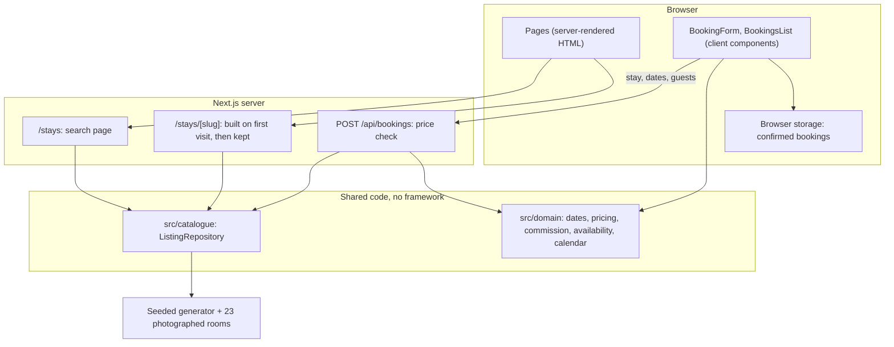

# Architecture

Planned design. Only the feasibility prototype described next exists; every other section is a plan.

## What exists today: the feasibility prototype

| Piece | Where | Why it is built this way |
|---|---|---|
| Pages | `src/app/` | Server components, pre-built to static HTML. They send no viewer code, so browsing and booking never depend on WebGL |
| Listings | `src/data/listings.ts` | Three hard-coded stays. The stays are invented and the photographs are real, and every page says so. Prices are integer cents. Replaced by validated seed data in slice 2 |
| Tour | `src/components/RoomTour.tsx` | The only client component. It imports Marzipano with a dynamic `import()` after the click, so the bundler puts the viewer in its own file that most visits never download |
| Fallback | Same component | WebGL is tested before anything is downloaded. Without it, or if loading fails, the visitor gets a message, the photos and the booking link |
| Sample media | `scripts/prepare-media.mjs`, `CREDITS.md` | Real 360-degree photographs released under CC0. The script shrinks each one to a 4096-pixel panorama and cuts the gallery photos out of the same photograph, so the gallery cannot show something the tour does not. The 20 to 40 MB originals stay out of the repository, and the script checks each against its published checksum |
| Credits | `src/app/credits/`, `src/data/listings.ts` | Each listing carries the credit for its photograph. The stay page and the credits page read it from there, so a picture cannot be added without saying where it came from |
| Booking | `src/app/stays/[slug]/book/` | A placeholder page. It proves booking is reachable without the tour. The real flow is slice 6 |

The tour moves through five states: `poster`, `loading`, `ready`, `unsupported` and `failed`. Naming
them keeps every screen a visitor can see deliberate, including the unhappy ones.

## Visual direction

Quiet and editorial: warm sand backgrounds, deep sea-blue panels, near-black text, a heavy high-contrast
serif (Gloock) for headings and generous empty space.

- **Tokens.** Colours and fonts are defined once in `src/app/globals.css`, and pages use the token names
  rather than raw values. Changing the palette is a one-file edit.
- **Three named text styles.** `display`, `eyebrow` and `text-link` carry the look. Naming them once
  keeps every heading and label consistent, which is most of what makes a page feel deliberate.
- **Logo.** `brand/logo-template.svg` is the editable master. `src/components/Mark.tsx` and
  `src/app/icon.svg` hold copies of its shapes, drawn as SVG so they stay sharp at any size and take
  the colour of the text around them.
- **Bands.** The home page alternates text on a plain background with a large photograph: hero, the
  idea, an image strip, features, the stays, a photo band, three steps, questions, footer. The stays use
  a large photograph with a dark panel laid over its edge, sides alternating.
- **Motion is optional.** A short rise on load and on scroll, written in CSS only. It is switched off
  for visitors who ask their device to reduce motion, and browsers without scroll-linked animation just
  show the finished page.
- **No JavaScript for layout.** The questions open and close with the browser's own `
`
  element, so the home page still ships no client code of its own.

## How the parts fit

| Piece | Where | Why it is built this way |
|---|---|---|
| Repository | `src/catalogue/types.ts`, `repository.ts` | Pages ask an interface for stays and never touch the data. A database can replace the generator without changing a page. See [ADR 0002](adr/0002-catalogue-and-rendering-at-scale.md) |
| Rooms and stays | `src/catalogue/rooms.ts`, `generate.ts` | A room is real: one 360° photograph, with the beds it shows and what it shows ("the bedroom", "the lapa"). A stay is invented (name, place, price) and points at a room. The site shows one stay per room, so no photograph appears twice. A larger catalogue that reuses photographs exists only for the scale benchmarks (`BOOK360_CATALOGUE_SIZE`). Three stays also carry a bathroom as a second tour |
| Beds and capacity | `src/catalogue/beds.ts` | A stay's guest count is never chosen: it is the sum of its beds (doubles and bigger 2, singles and daybeds 1, a sofa bed 2 when listed). Rooms and studios take exactly the beds their photograph shows; a house's photograph is its living room, so its 2 to 4 bedrooms are listed. Price per guest per night must sit in a band for the type (Room R700 to R1,500, Studio R600 to R1,200, House R450 to R800). Unit tests check every stay |
| Search | `src/app/stays/page.tsx`, `src/catalogue/query.ts` | A plain GET form puts the filters in the address, so a search can be shared, reloaded and walked with Back. One page of 24 is sent, whatever the catalogue size |
| Stay pages | `src/app/stays/[slug]/` | Featured stays are built ahead of time; the rest on first visit, then kept. Build time does not grow with the catalogue |
| Domain rules | `src/domain/` | Pure functions with no framework imports, so the browser, the server and the unit tests all run the same code |
| Booking | `src/components/BookingForm.tsx`, `src/app/api/bookings/route.ts` | The browser shows a live price; the server recalculates it and its answer is the one saved. The browser never sends an amount. See [ADR 0003](adr/0003-booking-and-commission.md) |
| Saved bookings | `src/lib/bookings.ts` | Browser storage, wrapped so a blocked or full store means "no bookings", not a broken page |
| Commission | `src/domain/pricing.ts`, `src/app/hosts/` | 3% of the room charge, in whole cents, from the host's side. One function serves the booking flow and the hosts' calculator |
| Header and menu | `src/components/SiteHeader.tsx`, `MobileMenu.tsx`, `SectionLink.tsx` | A three-column grid keeps "Book a room" in the exact centre whatever the sides measure. Links to home-page sections go through `SectionLink`, which scrolls to the section itself when the visitor is already on that page, because a link to the address you are already on does nothing. The phone menu is a native `<dialog>` opened with `showModal()`, which gives Escape to close, focus kept inside and the page behind made inert without extra code |
| Intro film | `src/components/IntroFilm.tsx`, `brand/intro/` | A Blender animation of the logo, pre-rendered to frames and drawn on a canvas. It plays once on its own clock when the section comes into view, because tying it to the scroll let fast scrollers skip it. Real text for the headline, a still image when motion is reduced or frames are slow. See [ADR 0004](adr/0004-scroll-driven-intro-animation.md) and [ADR 0005](adr/0005-intro-plays-on-entry.md) |
| Scroll effects | `src/app/globals.css`, `src/components/DragScroll.tsx` | CSS scroll-linked animations run without JavaScript and are switched off for reduced motion and unsupported browsers. The draggable strip adds code only for mouse and keyboard; phones use native scrolling |

Planned connections to outside services are in [integrations](integrations.md).

## Phones first

Most visitors will arrive on a phone, so the narrow layout is the one held to a standard.

- **Narrowest target: 360 pixels.** Styles are written for the phone and widened with `sm:` and `lg:`
  prefixes, so the phone layout is the default rather than an afterthought.
- **Menu without JavaScript.** Below the `lg` width the header links fold into a menu built on the
  browser's own `
` element.
- **Reserve is always in reach.** On a stay page a bar with the price and a Reserve button sticks to the
  bottom of the screen. It uses `position: sticky`, not `fixed`, so it stays inside the page and never
  covers the footer.
- **Finger-sized targets.** Every button and stand-alone link is at least 44 pixels tall. Text links get
  invisible padding above the words rather than a bigger font. Links inside a sentence are exempt.
- **Show the thing, not a symbol of it.** The "What you get" grid uses the unwrapped panorama, a real
  gallery picture, real figures and real keys instead of icons.

## Testing

| Kind | Where | What it proves |
|---|---|---|
| End-to-end | `tests/e2e/`, run by Playwright | A real browser opens the production build at a desktop size, a phone size and a narrow 360-pixel phone size. It checks that nothing for the tour downloads before the click, that the tour opens and closes by keyboard, that the fallback works without WebGL, that booking is reachable without the tour, that the honesty labels are present and that no page scrolls sideways. On the phone sizes it also checks the menu, the sticky Reserve bar, opening the tour by touch and the 44-pixel minimum for buttons and links |
| Quality | `tests/e2e/quality.spec.ts`, `helpers/audit.ts` | Every page, at desktop and phone sizes: one main heading, no skipped heading levels, image descriptions, named controls, labelled fields, unique ids, WCAG AA text contrast on solid backgrounds, visible keyboard focus, no sideways scrolling, a title per page |
| Tours | `tests/e2e/tours.spec.ts` | All 26 tours open and draw a real picture, judged from a screenshot because a WebGL canvas cannot be read back |
| Booking edge cases | `tests/e2e/booking-edge.spec.ts` | Forged or impossible requests are refused by the server; a past date is refused by the form; blocked storage is handled; booking works by keyboard alone |
| Looking | `scripts/capture-pages.mjs` | Saves a full-page picture of every page at both sizes into `test-results/screens/`. Tests cannot judge whether a page looks right, so this is for human eyes |

Playwright starts the site itself (`npm run build`, then `npm run start`) because the dev server behaves
differently: it fetches the tour's code early. Unit tests in `tests/unit/` cover the domain rules, the catalogue generator, the calendar file and the address parser. They run with Node's built-in test runner, which needs no extra package.

## Application

A Next.js site deployed on Vercel. Seeded typed JSON supplies properties, room types, amenities,
date-based sample pricing and tour metadata. Favourites and demo bookings stay in browser storage.

## Pages

Search and results, listing details, room tour, date and guest selection, price review, confirmation.
Search filters live in the URL.

## Data rules

Money in integer minor units with a currency. Accommodation nights as date-only values in half-open
ranges `[checkIn, checkOut)`.

## Tour component

Load the viewer dynamically when opened, showing a lightweight poster first. Provide keyboard-accessible
hotspots and a conventional gallery fallback. WebGL failure never blocks booking.

Real 360-degree panoramas are the reliable first experience. Flat photos support a guided gallery,
and do not become accurate panoramas automatically.

## Tour provenance

Each tour has a manifest of source photos, capture permission, generation method, tool and model
version, generation date, known gaps and review status. Original captures stay separate from inferred content.

## Media delivery

Serve finished media as static assets or from a direct storage path. Vercel Functions have a 4.5 MB
payload limit, so large files must not pass through them. Static assets still have their own deployment
and transfer limits, so validate a real exported scene against the current plan first.

## Deployment

Today: Vercel's GitHub integration builds every push. A push to `main` updates the production site,
which is served on a custom subdomain through a DNS CNAME record pointing at Vercel. Every other branch
gets its own preview address, so a change can be checked on a phone before it is merged. Vercel, not
the repository, holds the hosting settings, so nothing about the domain or account lives in this code.
There is no CI workflow yet; tests run locally with `make test`.

The target once CI exists: pull requests run lint, type checks, unit tests, build and Playwright. Vercel creates previews with Git
Fork Protection enabled and no sensitive variables. Merging to the production branch deploys. Roll back
by restoring a known-good deployment, and record the asset version with the application version.

## Optional later backend

One application and PostgreSQL, with authenticated server operations and server-calculated prices. A
single rental rejects overlapping dates with an exclusion constraint. Hotel room types need per-night
capacity accounting. Review hosting terms and costs first.
